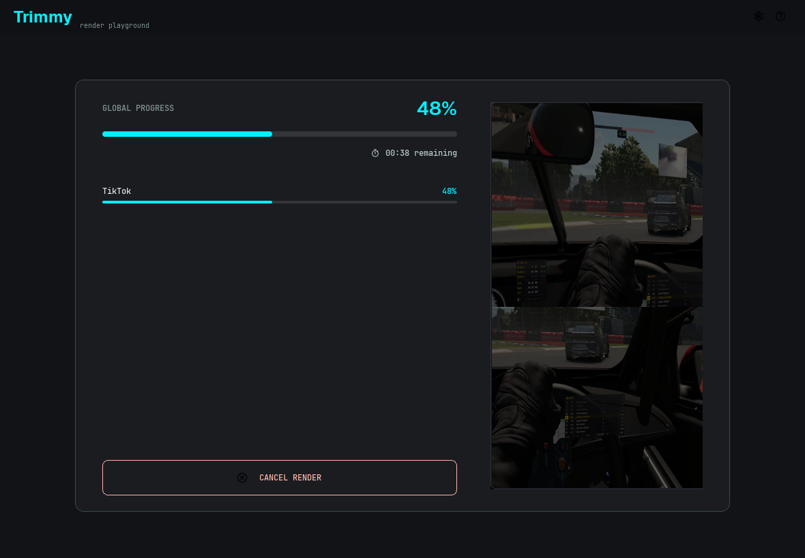
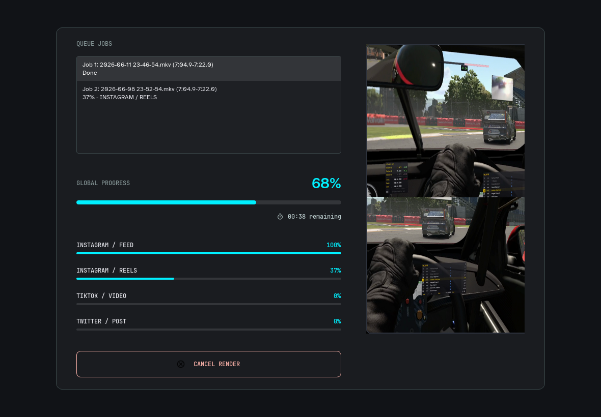

# Rendering

Trimmy renders with ffmpeg.

The editor prepares a render specification from:

* the source video path,
* the selected trim range,
* the `TOP` and `BOTTOM` crop rectangles,
* the split ratio,
* the selected platform target,
* the selected quality mode.

Then ffmpeg encodes the final vertical output.

## Platform presets

| Platform | Format | Resolution | Max FPS | Max Size |
| --- | --- | --- | --- | --- |
| Instagram | Feed, Reels, Stories | 1080x1920 | 60 | 300 MB |
| TikTok | Video | 1080x1920 | 60 | 4 GB |
| X | Post | 1080x1920 | 60 | 512 MB |
| WhatsApp | Chat, Status | 720x1280 | 30 | 16 MB |
| Telegram | Message | 1080x1920 | 60 | 2 GB |

## Quality modes

Trimmy supports platform-aware output settings.

* `Max`: higher quality, larger files, slower encode.
* `Optimized`: smaller files, faster encode.

WhatsApp targets are size-sensitive, so Trimmy caps bitrate for the 16 MB limit.

## Single render

Click `Render Video` when the current trim is ready.

```text
source.mkv -> source_tiktok_video_optimized.mp4
```

<figure markdown="span">
  { .trimmy-screenshot }
  <figcaption>A single render shows global progress plus the active platform target.</figcaption>
</figure>

## Queue render

Use `Send to Queue` when you want to keep the current trim and continue editing.

Use `Render Queue` when all queued trims are ready.

```text
clip_1_instagram_reels_optimized.mp4
clip_1_tiktok_video_optimized.mp4
clip_2_instagram_reels_optimized.mp4
clip_2_tiktok_video_optimized.mp4
```

<figure markdown="span">
  { .trimmy-screenshot }
  <figcaption>Queue rendering tracks each trim and each platform target.</figcaption>
</figure>

## Results, cancellation, and retry

A failed segment does not stop later segments, targets, or queued cuts. The final
results dialog lists every output with its cut, target, segment boundaries,
destination, status, and any encoder error. Open **Show Details** to read the report.

**Cancel Render** stops the active encoder and prevents remaining work from
starting. Completed files are preserved; the interrupted attempt's temporary file
is deleted. Cancelled and unattempted outputs have separate statuses. Any cleanup
error appears in the report.

Choose **Retry failed** in the results dialog to render only failed segments using
the original saved settings and destinations. Successful, cancelled, and
unattempted outputs are excluded. Repeated failures remain in the updated report.
Changing crops or the split ratio in the editor creates new work, independent of
retrying the saved cut. Existing output files are never replaced.
